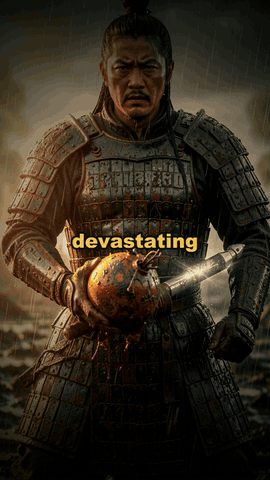
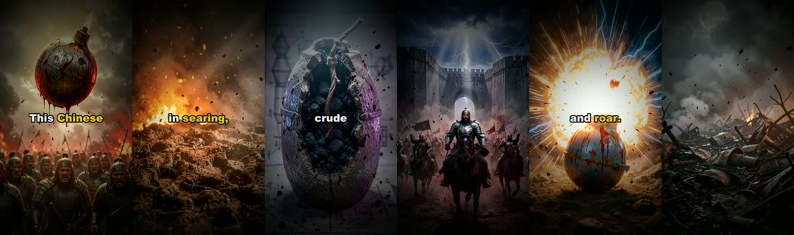
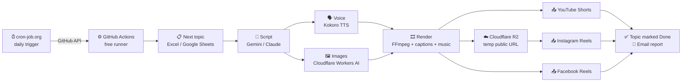

<div align="center">

# 🎬 AI Shorts Autopilot

**A fully automated, 100% free faceless-video factory.**
Topic → script → voice → AI images → cinematic edit → captions → upload to YouTube Shorts, Instagram Reels & Facebook Reels — every day, on autopilot, with **zero monthly cost**.

[](https://www.python.org/)
[](docs/07-automation-24x7.md)
[](docs/03-cloudflare.md)
[](docs/02-ai-keys.md)
[](https://ffmpeg.org/)
[](LICENSE)
[](#-what-does-it-cost)

<br>

<a href="https://www.youtube.com/@BladeArchives1"></a>

**▶ Every video on these [11 channels](#-11-channels-running-on-this-pipeline) (like [@BladeArchives1](https://www.youtube.com/@BladeArchives1)) was generated and uploaded by this exact pipeline.**
<br><sub>Preview above is a real output (sound on: <a href="docs/media/sample-blade-archives.mp4">download the full sample MP4</a>).</sub>

<br>



</div>

---

## 📺 See it in action

One top Short from **each of the 11 channels**. All of them were written, voiced, illustrated, edited and uploaded by this pipeline with **no human in the loop**. Click any thumbnail to watch.

<table>
<tr>
<td align="center" width="25%"><a href="https://www.youtube.com/shorts/Ix9woSnXPr0"></a><br><b>Blade Archives</b><br><sub>Medieval Trebuchet Secrets<br>👁 10K views</sub></td>
<td align="center" width="25%"><a href="https://www.youtube.com/shorts/NNIOBWfEIwg"></a><br><b>Fracture Layer</b><br><sub>AI Solved a 50-Year Biology Mystery<br>👁 1.3K views</sub></td>
<td align="center" width="25%"><a href="https://www.youtube.com/shorts/7_D5FsEoBxo"></a><br><b>Erased Lore</b><br><sub>The WW2 Order That Shot Retreating Soldiers<br>👁 1.3K views</sub></td>
<td align="center" width="25%"><a href="https://www.youtube.com/shorts/X0hlUZGAp30"></a><br><b>Ruined Clock</b><br><sub>Angkor Wat's Water Technology<br>👁 1.2K views</sub></td>
</tr>
<tr>
<td align="center" width="25%"><a href="https://www.youtube.com/shorts/-mnp1vFvsV0"></a><br><b>Filed And Forgotten</b><br><sub>Three Boy Scouts Murdered at Camp, 1977<br>👁 1.2K views</sub></td>
<td align="center" width="25%"><a href="https://www.youtube.com/shorts/FEmbNsUfe0M"></a><br><b>Covered Pages</b><br><sub>America's Orphan Trains<br>👁 1K views</sub></td>
<td align="center" width="25%"><a href="https://www.youtube.com/shorts/pglxipAXNlE"></a><br><b>Myth Bleed</b><br><sub>Aztec Goddess of Filth & Forgiveness<br>👁 1K views</sub></td>
<td align="center" width="25%"><a href="https://www.youtube.com/shorts/bbNbDI8sojs"></a><br><b>The Cursed Map</b><br><sub>The Bridge Where Dogs Jump<br>👁 838 views</sub></td>
</tr>
<tr>
<td align="center" width="25%"><a href="https://www.youtube.com/shorts/2A0Pd3Nvgog"></a><br><b>Restricted Lore</b><br><sub>The Georgia Guidestones Mystery<br>👁 452 views</sub></td>
<td align="center" width="25%"><a href="https://www.youtube.com/shorts/B_Ngw8TmkpE"></a><br><b>Classified Cognition</b><br><sub>Little Albert: The Baby Conditioned to Fear<br>👁 337 views</sub></td>
<td align="center" width="25%"><a href="https://www.youtube.com/shorts/Ubv4W59UIRA"></a><br><b>Muslim Ummah Awareness Hub</b><br><sub>Damascus ki Paani wali Ghadi (Urdu/Hindi)<br>👁 143 views</sub></td>
</tr>
</table>

👉 All channels with their Instagram and Facebook links: [11 channels running on this pipeline](#-11-channels-running-on-this-pipeline)

---

## 📡 11 channels running on this pipeline

Each channel has its own prompt, voice, music mood and caption colour. All of them post daily, fully automated, from a single GitHub Actions run.

| # | Channel | Niche | YouTube | Instagram | Facebook |
|:-:|---|---|:-:|:-:|:-:|
| 1 | **Blade Archives** | Ancient weapons & warfare | [@bladearchives1](https://www.youtube.com/@bladearchives1) | [@blade_archives](https://www.instagram.com/blade_archives/) | [Page](https://www.facebook.com/1364659166722912) |
| 2 | **Muslim Ummah Awareness Hub** | Forgotten Muslim scientists & Islamic history (Hindi/Urdu) | [@muslim_ummah_awareness_hub](https://www.youtube.com/@muslim_ummah_awareness_hub) | [@muslim_ummah_awareness_hub_](https://www.instagram.com/muslim_ummah_awareness_hub_/) | [Page](https://www.facebook.com/104313485677148) |
| 3 | **Fracture Layer** | Strange science & unsolved mysteries | [@fracturelayer](https://www.youtube.com/@fracturelayer) | [@fracture_layer](https://www.instagram.com/fracture_layer/) | [Page](https://www.facebook.com/1273556632512714) |
| 4 | **Filed And Forgotten** | True crime & cold cases | [@filedandforgottn](https://www.youtube.com/@filedandforgottn) | [@filed_and_forgotten1](https://www.instagram.com/filed_and_forgotten1/) | [Page](https://www.facebook.com/1232850446587692) |
| 5 | **Ruined Clock** | Lost civilizations & ancient mysteries | [@ruinedclock](https://www.youtube.com/@ruinedclock) | [@ruined_clock](https://www.instagram.com/ruined_clock/) | [Page](https://www.facebook.com/1334185009778956) |
| 6 | **Myth Bleed** | Mythology & dark gods | [@mythbleed](https://www.youtube.com/@mythbleed) | [@myth_bleed](https://www.instagram.com/myth_bleed/) | [Page](https://www.facebook.com/1329967713528184) |
| 7 | **Erased Lore** | WW2 & military secrets | [@erasedlore](https://www.youtube.com/@erasedlore) | [@erased_lore1](https://www.instagram.com/erased_lore1/) | [Page](https://www.facebook.com/1245093492029691) |
| 8 | **The Cursed Map** | Cursed & haunted places | [@the-cursed-map](https://www.youtube.com/@the-cursed-map) | [@the_cursed_map](https://www.instagram.com/the_cursed_map/) | [Page](https://www.facebook.com/1281311481736866) |
| 9 | **Covered Pages** | Dark history they deleted | [@coveredpages](https://www.youtube.com/@coveredpages) | [@covered_pages1](https://www.instagram.com/covered_pages1/) | [Page](https://www.facebook.com/1294736537062110) |
| 10 | **Classified Cognition** | Dark psychology | [@classifiedcognition](https://www.youtube.com/@classifiedcognition) | [@classified_cognition](https://www.instagram.com/classified_cognition/) | [Page](https://www.facebook.com/1343132568885174) |
| 11 | **Restricted Lore** | Hidden truths & cover-ups | [@restrictedlore](https://www.youtube.com/@restrictedlore) | [@restrictedlore1](https://www.instagram.com/restrictedlore1/) | [Page](https://www.facebook.com/1275179939018648) |

> The prompts for all 11 channels are included in [`prompts/`](prompts/) — use them as-is or as templates for your own niche.

---

## ✨ Features

| | |
|---|---|
| 🧠 **AI script writer** | Gemini (free) with automatic key rotation, plus optional Claude / OpenAI-compatible fallbacks. Per-channel prompt files with hook → story → payoff structure tuned for retention. |
| 🗣️ **Natural voiceover** | [Kokoro v1.0](https://github.com/thewh1teagle/kokoro-onnx) neural TTS runs free on CPU, per-channel voices, custom pronunciation dictionary; Microsoft Edge TTS fallback (incl. Hindi / Urdu voices). |
| 🖼️ **Free AI images** | Cloudflare Workers AI (FLUX.1 schnell). Rotates across any number of workers and auto-skips a worker once its daily free quota is used. |
| 🎞️ **Cinematic editing** | Ken-Burns motion, 1.5× supersampled render, per-mood color grades, flash cuts, progress bar, watermark, hook boost, optional HyperFrames motion-graphic cards. |
| 💬 **Word-synced captions** | faster-whisper alignment → bold animated subtitles in each channel's accent colour. |
| 🎵 **Smart audio** | Mood-matched CC0 music library, auto-ducked under the voice, SFX director (boom / whoosh / riser), loudness-normalised to −14 LUFS. |
| 🖼️ **Thumbnails & metadata** | Auto thumbnails, viral title, description, hashtags, engagement question. |
| 📤 **Multi-platform upload** | YouTube Shorts (official API), Instagram Reels & Facebook Reels (Graph API), TikTok (optional). |
| 📋 **Topic queue** | Excel file *or* Google Sheets — one tab per channel; finished topics are marked `Done` automatically. |
| 🔁 **Crash-safe** | SQLite resume (finished scenes are never re-rendered), retries with back-off, per-channel isolation. |
| 📊 **Analytics dashboard** | Local FastAPI dashboard for YouTube / Instagram / Facebook / TikTok stats + retention tracking. |
| ☁️ **24/7, $0** | GitHub Actions (free & unlimited on public repos) + cron-job.org trigger. Your PC can be off. |
| 🔐 **Secure by design** | No secret ever lives in the repo. Everything comes from encrypted GitHub Secrets and is masked in public logs. |

---

## 🏗️ How it works



Per video: **1 LLM call → a scene list → one image + one voice line per scene (in parallel) → scene clips → merged short (≤ 175 s) → uploads.**

---

## 🚀 Quick start

> **New to all of this?** Follow the guides in order — every click is explained.
> **Roman Urdu / Hindi guide:** [docs/URDU-GUIDE.md](docs/URDU-GUIDE.md)

| Step | Guide | Time |
|---|---|---|
| 1 | [Prerequisites & local install](docs/01-prerequisites.md) | 15 min |
| 2 | [AI keys — Gemini (free) + optional Claude/OpenAI](docs/02-ai-keys.md) | 5 min |
| 3 | [Cloudflare — free image worker + R2 storage](docs/03-cloudflare.md) | 20 min |
| 4 | [YouTube, Instagram & Facebook APIs](docs/04-social-apis.md) | 40 min |
| 5 | [Topics — Excel or Google Sheets](docs/05-topics.md) | 10 min |
| 6 | [GitHub repository & secrets](docs/06-github-secrets.md) | 15 min |
| 7 | [Run 24/7 for free with cron-job.org](docs/07-automation-24x7.md) | 10 min |
| ? | [Troubleshooting & FAQ](docs/08-troubleshooting.md) | — |

### TL;DR for experienced users

```bash
git clone https://github.com/NoobSaifii/ai-shorts-autopilot.git
cd ai-shorts-autopilot
pip install -r requirements.txt
cp config.example.yaml config.yaml         # fill in your keys
python auth_yt.py                           # one-time YouTube login per channel
python daily_runner.py --channel "Blade Archives" --no-upload   # test render
python scripts/make_secrets.py --upload YOUR_USER/YOUR_REPO     # push secrets to GitHub
```

Then point a cron-job.org job at the `workflow_dispatch` endpoint ([guide](docs/07-automation-24x7.md)).

---

## 💸 What does it cost?

| Service | Used for | Free tier | Cost |
|---|---|---|---|
| GitHub Actions | Rendering + uploading | Unlimited minutes on **public** repos | **$0** |
| cron-job.org | Daily trigger | Unlimited jobs | **$0** |
| Google Gemini API | Scripts | Generous free tier | **$0** |
| Cloudflare Workers AI | Images | 10,000 neurons / day per account | **$0** |
| Cloudflare R2 | Temporary hosting for Instagram | 10 GB storage, free egress | **$0** |
| Kokoro / Edge TTS | Voice | Open source / free | **$0** |
| YouTube / Meta APIs | Uploads | Free | **$0** |

---

## 📁 Project structure

```text
├── daily_runner.py          # ⭐ entry point used by GitHub Actions (all channels)
├── main.py                  # interactive local runner (pick a channel / topic)
├── scheduler.py             # generation for one channel (used by the runner)
├── auth_yt.py               # one-time YouTube OAuth per channel
├── setup_yt_analytics.py    # optional: YouTube analytics tokens
├── config.example.yaml      # copy to config.yaml (gitignored)
├── topics.xlsx              # sample topic queue (one sheet per channel)
├── prompts/                 # one script-writing prompt per channel
├── modules/                 # script, TTS, images, captions, video, thumbnails
├── pipeline/                # orchestrator, parallel scene processor, merger
├── uploaders/               # YouTube, Meta (FB + IG), TikTok
├── analytics/ + dashboard/  # stats collectors + FastAPI dashboard
├── cloudflare-worker/       # free AI image API (deploy to Cloudflare)
├── motion_templates/        # HyperFrames motion-graphic cards
├── assets/                  # fonts, CC0 music by mood, original SFX
├── scripts/make_secrets.py  # builds/uploads GitHub secrets from local files
└── .github/workflows/       # the daily automation
```

---

## 🔐 Security

- `config.yaml`, all `*_credentials_*.json`, `client_secrets.json`, `google_service_account.json`, `gemini_keys.txt` are **gitignored** — they never leave your machine except as encrypted GitHub Secrets.
- The workflow registers every key/token/ID from your config with `::add-mask::`, so they appear as `***` in public Action logs.
- Credential files are deleted from the runner at the end of every job.
- A [Gitleaks](https://github.com/gitleaks/gitleaks) scan runs on every push and pull request.
- Found a vulnerability? See [SECURITY.md](SECURITY.md).

> ⚠️ **Never** paste API keys into issues, pull requests, commit messages, or code. If you leak one, revoke it immediately.

---

## 🤝 Contributing

PRs welcome — see [CONTRIBUTING.md](CONTRIBUTING.md). Ideas: new channel prompts, more TTS voices, long-form (16:9) mode, more upload targets.

## ⚖️ Responsible use

Follow each platform's policies — label AI-generated content where required (YouTube's *altered or synthetic content* setting), don't spam, and fact-check what you publish. You are responsible for the content your channels post.

## 📜 License

[MIT](LICENSE) © [NoobSaifii](https://github.com/NoobSaifii). Bundled music is CC0 / public domain (see `CREDITS.txt` files); the Anton font is under the SIL Open Font License.

<div align="center">
<br>
If this project helped you, please ⭐ the repo and subscribe to <a href="https://www.youtube.com/@BladeArchives1">@BladeArchives1</a>!
</div>
